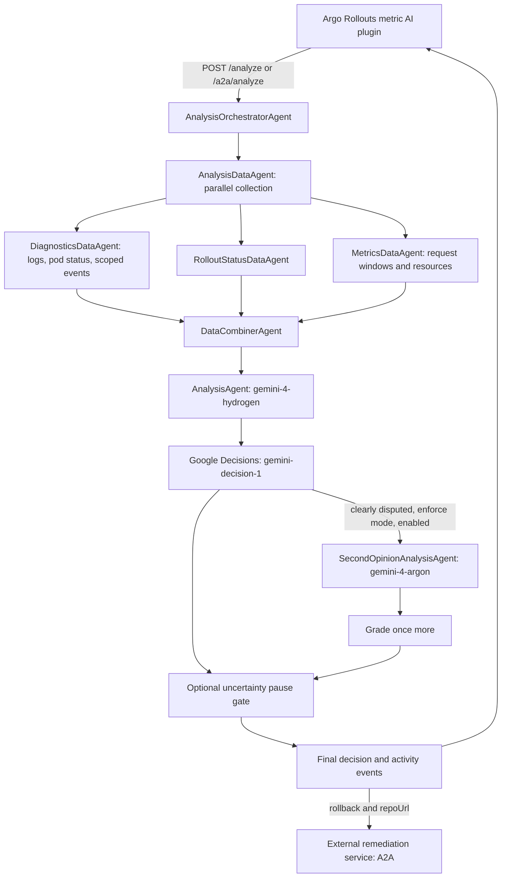

# Kubernetes AI/Ops Agent Team - Google Gemini

Analyze Argo Rollouts canaries using deterministic evidence collection, Gemini 4
Hydrogen analysis, and Google Decision 1 grading. The logical agent roles mirror
`kubernetes-aiops-agent`: evidence first, a primary conclusion, a quality check,
optional independent second opinion, an opt-in promotion hold, then asynchronous
remediation of the final rollback.

## Architecture



See [architecture and isolation details](docs/architecture.md). There are **eight
logical agent types, only two generative roles**, not eight deployments:

| Role | Implementation |
|---|---|
| AnalysisOrchestratorAgent | Deterministic pipeline; `LeadOrchestratorAgent` remains an alias |
| AnalysisDataAgent | Parallel evidence coordinator |
| DiagnosticsDataAgent | Stable/canary logs, readiness, restarts, and pod-UID-scoped events |
| RolloutStatusDataAgent | Named Rollout spec/status |
| MetricsDataAgent | Application counter windows, error rates, latency, CPU/memory snapshots |
| DataCombinerAgent | Validated evidence bundle, including missing-data errors |
| AnalysisAgent | Gemini 4 Hydrogen with native structured outputs and no tools |
| SecondOpinionAnalysisAgent | Optional independent Gemini 4 Argon analysis of the same evidence |

Decision 1 is the grader, not another generative agent or the primary verdict
selector. Remediation is delegated to a separate service, which owns its model,
sandbox, tests, and GitHub credentials. Native Gemini REST calls avoid a dependency
on the tool-executing Antigravity SDK or a prerelease Decisions SDK.

## Grading and confidence

The public [Decisions API](https://aistudio.google.com/docs/decisions-api) uses
`gemini-decision-1` at `POST /v1beta/decisions`. Two independent yes/no questions
grade the proposed conclusion: `conclusion_contradicted` and
`evidence_sufficient`. The parser requires both valid `noul` probabilities
(0.01-0.99). Safety blocks, missing answers, timeouts, and HTTP failures are
explicit grader-unavailable events, **not fabricated rollback decisions**.

The compatibility support score follows the Java pipeline's veto/neutral bands.
It is a derived score, not a separately calibrated probability. Thin evidence
alone is neutral. Only a score below 0.30 can lower effective confidence or
trigger a configured second opinion; that conclusion is graded at most once more.
If grading is unavailable, the selected analysis model's confidence stands.

**Grading defaults to `enforce` mode.** Disputed scores affect effective confidence
and can trigger a configured second opinion. Set `DECISION_GRADING_MODE=shadow`
to observe scores without affecting effective confidence or triggering escalation.
Validate labeled healthy, code-error, resource, latency, thin-data, and disagreement
cases with your own traffic; Typesafe calibration does not transfer automatically
to Google.

HTTP `confidence` always stays the final analysis model's self-reported integer
0-100. `effectiveConfidence` drives the pause gate and decision events. The request
can opt into `pauseOnUncertainty` with `uncertaintyThreshold` (default 50, clamped
0-100). Only a promotion below the threshold pauses. The named Rollout is patched
with `spec.paused=true` and read back before returning `pausedRollout`. A required
pause failure returns HTTP 500, never an unheld successful promotion.

## Evidence and deployments

The existing multi-role image and HTTP endpoints are retained:

| CLI role | Endpoint | Purpose |
|---|---|---|
| `orchestrator` | `/analyze`, `/a2a/analyze`; `/events`, `/a2a/events` | Analysis and activity feed |
| `logs` | `/analyze/logs` | Deterministic stable/canary logs |
| `events` | `/analyze/events` | Pod status and scoped lifecycle events |
| `metrics` | `/analyze/metrics` | Deterministic application/resource metrics |
| `log-proxy` | `/pod-logs` | Trusted, namespace-restricted Kubernetes log reader |

Collector responses include the legacy `analysis` text field and a structured
`evidence` envelope. Collectors no longer take model-selected tool arguments or
make model calls. Collector model settings (`logModel`, `metricsModel`, `eventModel`
and their environment variables) are obsolete.

Application metrics default to `/q/metrics` on port 8080, read through the
Kubernetes pod proxy. Supported Prometheus counters are `http_requests_total`,
`http_requests_error_total` (or `http_requests_success_total`), and
`http_request_duration_seconds_sum`/`_count`. Labeled series are summed, and
deltas exclude lifetime warmup. Summary p95/p99 values are labeled as maximum
per-pod observations, not fleet percentiles. The slowest pod's window mean latency
is retained so fleet averages cannot hide one slow replica.

Sampling takes one 10-second window and up to three further waits until 500
canary requests are observed. Counter resets, changed series, new/disappeared
pods, missing counters, and inadequate traffic are explicit incomplete evidence.
CPU/memory snapshots are supplementary; they cannot prove leaks or throttling.

The log collector **remains in gVisor**, with no ServiceAccount token or API key,
non-root execution, and the trusted log proxy as its only path to logs. The
proxy's namespace deny-list is retained. Other collectors have read permissions;
only the orchestrator's separate ServiceAccount can patch Rollouts. The supplied
ClusterRole permits cross-namespace analysis; narrow it to workload-specific
Roles/RoleBindings for deployments that do not need that scope.

## Configuration

| Environment variable | Default / purpose |
|---|---|
| `GEMINI_API_KEY` | Required by the orchestrator only |
| `ANALYSIS_MODEL` | `gemini-4-hydrogen`; legacy `ORCHESTRATOR_AGENT_MODEL` also recognized |
| `ANALYSIS_THINKING_LEVEL` | `high`; Hydrogen also supports `low`, `medium`, `xhigh` |
| `ANALYSIS_SECOND_OPINION_MODEL` | Empty/disabled; set `gemini-4-argon` to enable in enforce mode |
| `ANALYSIS_SECOND_OPINION_THINKING_LEVEL` | `high`, independently configurable |
| `DECISION_AGENT_MODEL` | `gemini-decision-1` |
| `DECISION_GRADING_MODE` | `enforce`; `shadow` observes scores without veto/escalation |
| `DECISIONS_API_URL` | Google `https://generativelanguage.googleapis.com/v1beta/decisions` |
| `ANALYSIS_MIN_CANARY_REQUESTS` | `500` |
| `ANALYSIS_SAMPLE_WINDOW_SECONDS` | `10` (greater than 0, at most 30) |
| `ANALYSIS_MAX_SAMPLE_WAITS` | `3` (0-3 additional windows) |
| `APPLICATION_METRICS_PORT`, `APPLICATION_METRICS_PATH` | `8080`, `/q/metrics` |
| `LOGS_AGENT_URL`, `EVENTS_AGENT_URL`, `METRICS_AGENT_URL` | Remote collectors; otherwise local collection |
| `LOG_PROXY_URL` | Required wherever log collection runs |
| `REMEDIATION_AGENT_URL` | Empty/disabled; exact A2A JSON-RPC endpoint |
| `REMEDIATION_AGENT_TOKEN` | Optional bearer token for the external service |
| `REMEDIATION_TIMEOUT_SECONDS` | `2100` (at most 35 minutes, background only) |

The analysis context can override `model`, `secondOpinionModel`, and
`decisionModel`. An empty `secondOpinionModel` disables escalation for a request.
Hydrogen uses a 65,536-token output cap; Argon/Carbon use the 32,768-token
non-streaming REST cap. No sampling overrides, explicit caches, or model tools
are sent.

## Remediation and activity feed

After the final rollback, a configured `repoUrl` triggers background A2A
`SendMessage`, with `GetTask` polling if needed. The payload matches the Java
service contract: `repoUrl`, `baseBranch`, `issueCategory`, `title`, `rootCause`,
`analysis`, `diagnosticContext`. `CODE_BUG` requests a verified fix PR and
`OPERATIONAL` requests an issue; the remote service implements that policy.
Promotions never trigger remediation, including second-opinion reversals.

The verdict does not wait for remediation. The remote service must return a JSON
text artifact with `status`, optional `prLink`/`issueLink`, and optional `message`.
RPC errors, failed tasks, invalid artifacts, and timeouts produce error events.
This service neither reads repositories nor writes to GitHub. Shutdown cancels
its pending client tasks.

`GET /a2a/events?since=<id>` and `/events` preserve the bounded in-memory feed
shape `{id,timestamp,type,message,details}`. Quality, escalation, pause, final
decision, and remediation events appear in pipeline order.

## Run and verify

Requires Python 3.11+. Create a virtual environment and install dependencies:

```bash
python3 -m venv .venv
make install
make test
make run-orchestrator
```

For in-cluster use, build the image and apply `kubectl apply -k k8s/` after
configuring the API key secret, image reference, workload RBAC and optional remote
remediation endpoint. The log sandbox requires a `gvisor` RuntimeClass and the
`agents.x-k8s.io` Sandbox CRD. The checked-in image digest is not rebuilt
automatically by source changes.

When upgrading from an earlier release that used the retired shared RBAC
manifests, prune the old cluster-wide bindings manually (`kubectl apply -k`
does not delete removed resources) after confirming no workloads still use
`kubernetes-agents-sa`:

```bash
kubectl delete clusterrolebinding kubernetes-agents-rolebinding --ignore-not-found
kubectl delete clusterrole kubernetes-agents-role --ignore-not-found
kubectl delete serviceaccount kubernetes-agents-sa -n argo-rollouts --ignore-not-found
```

Example request (from an environment able to reach the orchestrator):

```bash
curl -X POST http://localhost:8080/analyze \
  -H 'Content-Type: application/json' \
  -d '{
    "userId": "argo-rollouts",
    "prompt": "Compare the canary against stable.",
    "context": {
      "namespace": "rollouts-test-system",
      "rolloutName": "canary-demo",
      "stableSelector": "role=stable",
      "canarySelector": "role=canary",
      "pauseOnUncertainty": true,
      "uncertaintyThreshold": 50
    }
  }'
```

The HTTP analysis deadline is 270 seconds, below the plugin's five-minute timeout.
Unit/HTTP tests mock Google and Kubernetes; they do not establish live model
access, model calibration, cluster RBAC, or external remediation availability.

## Recorded demo

This recording shows the earlier specialist-voting implementation, not the
current evidence-first pipeline:

<video src="https://github.com/user-attachments/assets/a2da0dde-814c-4f1b-8a2c-e58d13e17643" controls width="100%">
  <a href="https://github.com/user-attachments/assets/a2da0dde-814c-4f1b-8a2c-e58d13e17643">Download the recorded demo</a>.
</video>
