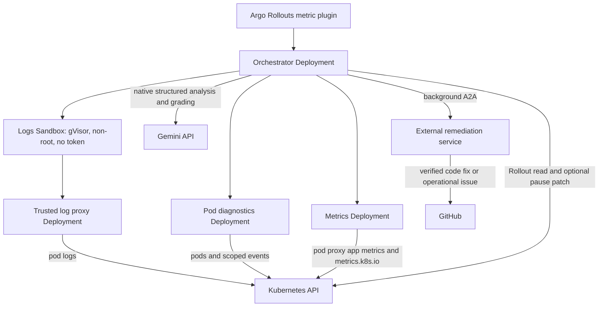

# Architecture: evidence-first Antigravity agent team

The Python agent mirrors the Java analysis pipeline's eight logical roles, while
using Google Gemini and Google Decisions instead of an OpenAI-compatible primary
and Typesafe grading. Logical roles do not require one deployment each.

## Request flow

1. `/analyze` or `/a2a/analyze` validates namespace, Rollout name, selectors, model
   overrides, operator notes, and the opt-in pause gate.
2. `AnalysisOrchestratorAgent` calls `AnalysisDataAgent`. Its three parallel workers
   are `DiagnosticsDataAgent`, `RolloutStatusDataAgent`, and `MetricsDataAgent`.
3. Diagnostics combines stable/canary logs from the isolated log collector with
   pod readiness/restart data and pod-UID-scoped events. Rollout status comes from
   the named `argoproj.io/v1alpha1` Rollout. Metrics samples application counters
   over bounded windows, keeping error rates, mean/worst-pod latency and resource
   snapshots. Unavailable data is an explicit error, never a healthy observation.
4. `DataCombinerAgent` builds a validated evidence bundle. `AnalysisAgent` sends
   that bundle and operator notes to `gemini-4-hydrogen` with native JSON Schema
   output. It has no tools or ability to execute generated code.
5. Google `gemini-decision-1` grades the proposed conclusion using independent
   contradiction and sufficiency questions. Missing answers, safety blocks, and
   invalid probabilities are grading failures, not rollback verdicts.
6. In opt-in `enforce` mode, a clearly disputed conclusion can trigger a configured
   `SecondOpinionAnalysisAgent` (`gemini-4-argon`). It sees the same evidence, not
   the primary answer. Its replacement conclusion is graded once; there is no
   recursive debate. Failed escalation retains the primary conclusion and grade.
7. An opt-in uncertainty gate pauses only promotion conclusions below threshold.
   The Rollout patch is read back before reporting `pausedRollout`. Failure of a
   required pause fails the HTTP measurement rather than silently promoting.
8. The final decision event precedes background external remediation. A final
   rollback with `repoUrl` delegates `CODE_BUG` or `OPERATIONAL` over A2A. A promotion
   does not remediate, even when it reverses the primary answer.

The `AnalysisAgent` and `SecondOpinionAnalysisAgent` are the two generative roles.
The six other roles are deterministic. The Decisions grader and remediation
coordinator are supporting components.

## Confidence semantics

The HTTP `confidence` remains the selected analysis model's self-reported value.
The grader's contradiction/sufficiency probabilities produce a compatibility
support score with the Java veto/neutral bands, not a calibrated overall
probability. Only a score below 0.30 changes effective confidence in `enforce`
mode. A neutral/thin grade does not lower confidence or trigger escalation.
Unavailable grading uses self-reported confidence, with an explicit error event.

The default `enforce` mode applies disputed grades to effective confidence and
can trigger a configured second opinion. Explicit `shadow` mode observes grading
without affecting the conclusion, effective confidence or escalation. Validate
against labeled fixtures and real traffic; do not assume Typesafe's calibration
transfers to Google. The primary model must still disclose missing/thin evidence
and reduce its self-reported confidence appropriately.

## Deployment and trust boundaries

Only the orchestrator needs `GEMINI_API_KEY`. No collector has a model, model
tools, or API key. Model output cannot select Kubernetes query arguments: plain
code uses the validated request selectors. Workload logs and event messages remain
untrusted input to the analyzer and grader; both prompts treat them as data.

The log collector retains its gVisor Sandbox CR, `automountServiceAccountToken:
false`, non-root UID, and trusted log-proxy-only access. The proxy preserves its
protected-namespace deny-list and bounded log reads; no model gets Kubernetes
credentials. This isolates log acquisition; it is not a claim that arbitrary
natural-language analysis is immune to prompt injection.

The orchestrator uses a separate ServiceAccount for Rollout read/patch access;
the shared collector account cannot pause Rollouts. Pod proxy reads require
`pods/proxy` permission. Default manifests use cross-namespace ClusterRoles;
deployments with fixed workload namespaces should replace them with narrower
Roles/RoleBindings.

The remote remediation service owns its sandbox, model and GitHub write
credentials. This agent only sends the typed Java-compatible request and reports
the A2A task artifact. Its optional bearer token is not sent to Google.

## Compatibility and failure behavior

The plugin's `{userId,prompt,context}` input and
`{analysis,rootCause,remediation,promote,confidence,pausedRollout?}` output remain.
`codeBug`, `votingRationale`, and `modelResults` remain additive dashboard fields;
`modelResults` now lists actual generative conclusions, not fabricated collector
votes. `effectiveConfidence`, `gradingMode`, and `evidenceStatus` are additive.

Existing collector role paths retain `analysis` text plus a new validated
`evidence` envelope. The HTTP activity feed retains
`{id,timestamp,type,message,details}` and supports `since`. Quality, escalation and
pause events extend the existing event types.

Invalid primary output is an HTTP failure, never a generated default verdict.
Failed collectors remain visible in evidence and activity errors. Grading errors
fall back explicitly; second-opinion errors retain the primary. A required pause
failure is an HTTP failure. External remediation errors cannot revise a returned
verdict and are reported through the feed. Client tasks are canceled at shutdown.

See [configuration and validation commands](../README.md). The old
`architecture.png` and recorded demo depict the previous specialist-voting design;
the diagrams above describe the current implementation.
