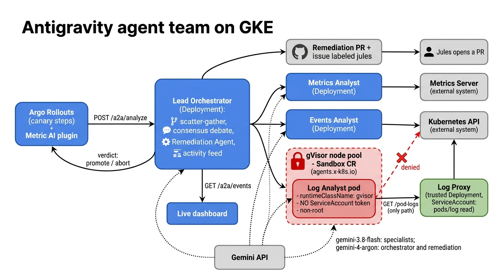
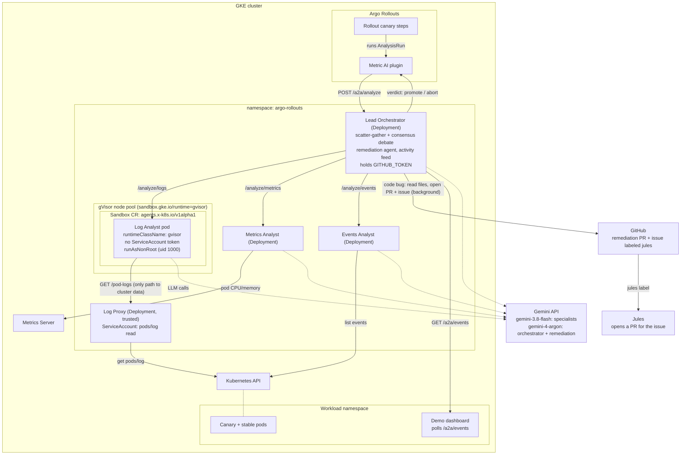

# Architecture: Antigravity agent team

The Antigravity agents analyze a canary rollout on behalf of the Argo Rollouts metric AI plugin.
A lead orchestrator fans the analysis out to three specialists in parallel, runs a consensus
debate, returns a promote/abort verdict, and (for code bugs) opens a remediation PR and a `jules`
issue in the background.

## Components

| Component | Runs as | Role |
|-----------|---------|------|
| Lead Orchestrator | Deployment | Receives `/a2a/analyze`, runs the three specialists concurrently, hosts the consensus debate, returns the verdict, starts remediation, and serves the activity feed (`/a2a/events`) |
| Log Analyst | **Sandbox CR in gVisor** | Analyzes pod logs. The only agent reading untrusted, workload-authored text (logs can carry prompt injection), so it is isolated |
| Metrics Analyst | Deployment | Compares canary and stable CPU/memory via the Metrics Server |
| Events Analyst | Deployment | Reads Kubernetes events for the canary pods |
| Log Proxy | Deployment (trusted) | Holds the ServiceAccount and serves `GET /pod-logs` to the sandboxed Log Analyst |
| Remediation Agent | In the orchestrator | For code bugs, reads the repo over the GitHub REST API, proposes a minimal fix, opens a PR, then a `jules`-labeled issue |

## Request flow

1. An Argo Rollouts `AnalysisRun` calls the metric AI plugin, which calls `POST /a2a/analyze` on the orchestrator.
2. The orchestrator calls the three specialists in parallel. The Log Analyst fetches logs through the Log Proxy.
3. The specialists' reports go into a consensus debate, which produces the verdict (promote or abort) and a `codeBug` flag.
4. The verdict returns to the plugin immediately, so the rollout can abort without waiting.
5. If `codeBug` is set, remediation runs in the background (150s timeout): it opens a PR and a `jules` issue, and Jules then opens its own PR.
6. Every step is emitted as an activity event. The dashboard polls `/a2a/events` and shows them live.

## Why the Log Analyst is sandboxed

| Layer | What it protects |
|-------|------------------|
| gVisor (`runtimeClassName: gvisor`) | Container escapes: syscalls hit a user-space kernel, not the host kernel |
| agent-sandbox `Sandbox` CR | Declarative single-pod lifecycle for the untrusted workload |
| `automountServiceAccountToken: false` | A compromised agent has no Kubernetes credentials |
| Log Proxy | The only component with pod/log read access, behind a narrow HTTP endpoint |
| `runAsNonRoot`, uid 1000 | No root in the container (the SDK needs `HOME=/tmp`) |

Manifests: [`k8s/agents.yaml`](../k8s/agents.yaml) and [`k8s/log-analyst-sandbox.yaml`](../k8s/log-analyst-sandbox.yaml).
The sandbox needs a `gvisor` RuntimeClass (GKE Sandbox) and the `agents.x-k8s.io` Sandbox CRD.
